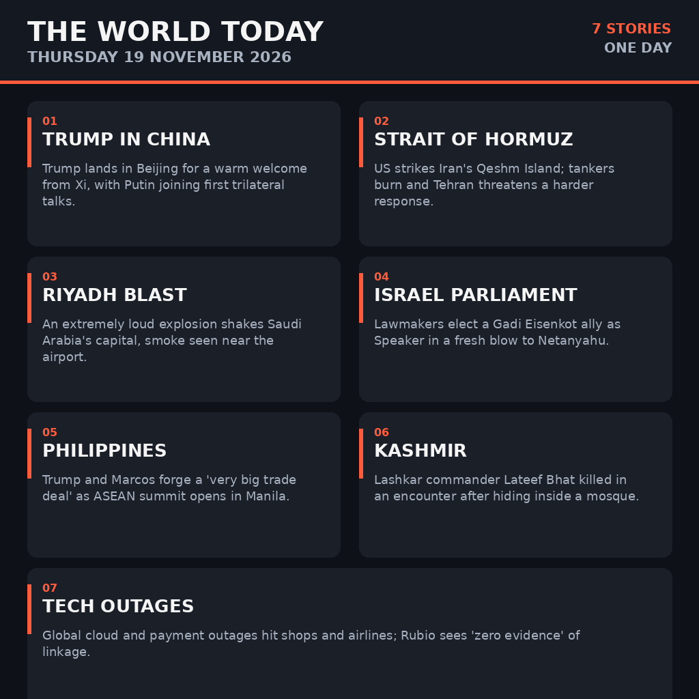

# The World Today: 19 November 2026

[](https://make.fun/bounty/news-image-20261119?utm_source=github&utm_medium=readme&utm_campaign=news-image-20261119)
[](https://make.fun/bounty/news-image-20261119/leaderboard?utm_source=github&utm_medium=readme&utm_campaign=news-image-20261119)
[](https://make.fun/bounty/news-image-20261119?utm_source=github&utm_medium=readme&utm_campaign=news-image-20261119)

This is an entry for the make.fun bounty **[Sum up 19 November's world news in one image](https://make.fun/bounty/news-image-20261119?utm_source=github&utm_medium=readme&utm_campaign=news-image-20261119)** (`news-image-20261119`).



## What `entry.png` is

`entry.png` is the submission: a 1024×1024 PNG (about 77 KB) that sums up the day's world news on one dark-themed front page. It is titled **"The World Today: Thursday 19 November 2026"** and has seven numbered story cards, each with a headline and a one-line summary:

| # | Story | Summary |
|---|-------|---------|
| 01 | Trump in China | Trump lands in Beijing for a warm welcome from Xi, and Putin joins the first trilateral talks. |
| 02 | Strait of Hormuz | US strikes Iran's Qeshm Island; tankers burn and Tehran threatens a harder response. |
| 03 | Riyadh blast | An extremely loud explosion shakes Saudi Arabia's capital, with smoke seen near the airport. |
| 04 | Israel parliament | Lawmakers elect a Gadi Eisenkot ally as Speaker in a fresh blow to Netanyahu. |
| 05 | Philippines | Trump and Marcos forge a "very big trade deal" as the ASEAN summit opens in Manila. |
| 06 | Kashmir | Lashkar commander Lateef Bhat is killed in an encounter after hiding inside a mosque. |
| 07 | Tech outages | Global cloud and payment outages hit shops and airlines; Rubio sees "zero evidence" of linkage. |

## How `main.ts` runs

`main.ts` is the entry point. It doesn't draw anything. It delivers the finished `entry.png` to the output directory and checks that the copy is valid:

1. **Pre-checks on the source.** It finds `entry.png` next to the script (using `import.meta.dirname`). It fails if the file is missing, isn't a regular file, is empty, or is larger than **1 MiB** (1,048,576 bytes).
2. **Copy.** It creates the output directory if needed, then copies the image to `<output dir>/entry.png`. The output directory comes from the `MAKEFUN_OUTPUT_DIR` environment variable and defaults to `/output`.
3. **Post-write check.** It reads the copied file back and confirms that it starts with the 8-byte PNG signature (`89 50 4E 47 0D 0A 1A 0A`) and that its size matches the source. If either check fails, it deletes the bad output, prints an error to stderr and exits with code `1`.

The script uses only Node built-ins (`node:fs/promises`, `node:path`), so there are no dependencies to install.

### Running it locally

The script needs a runtime that can run TypeScript directly and supports `import.meta.dirname`, such as Node.js 22.18+ (built-in type stripping), Bun or `tsx`:

```sh
# Write to ./output instead of the default /output
MAKEFUN_OUTPUT_DIR=./output node main.ts

# Alternatives
MAKEFUN_OUTPUT_DIR=./output bun main.ts
MAKEFUN_OUTPUT_DIR=./output npx tsx main.ts
```

If it succeeds, `./output/entry.png` is a byte-for-byte copy of `entry.png` and the script exits with code `0` without printing anything.

## License

This project is released under the [MIT License](https://opensource.org/licenses/MIT).
